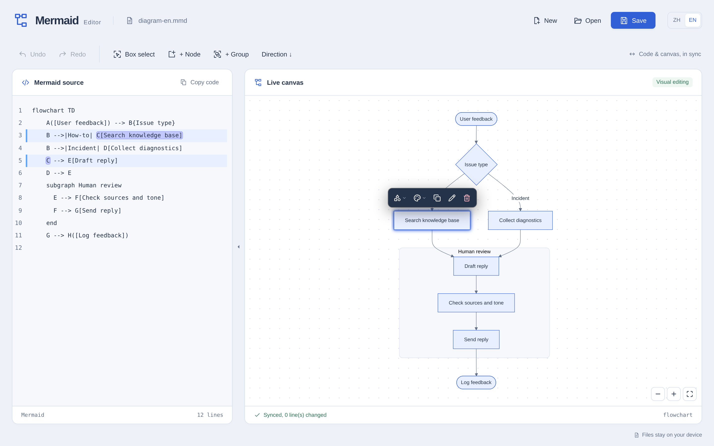
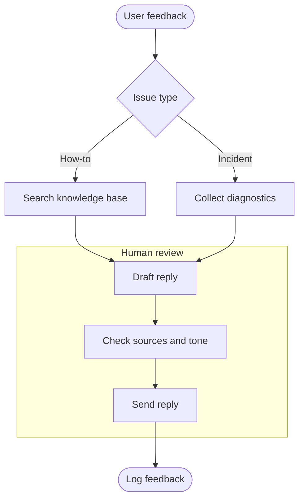

# Mermaid Editor

[中文](README.md) | **English**

> Agents draft the diagram. You make it right.

Mermaid Editor is a local-first visual editor for Mermaid diagrams, available in the browser and as a Windows desktop app; both share the same editing UI. Mermaid source on the left, a live canvas on the right: double-click a node to rename it, drag the blue dots to connect, pick a new shape or color, box-select nodes to group them, or flip the direction of the whole diagram. Canvas edits are written back to plain Mermaid text.

It is built for the loop where an agent (ChatGPT, Claude, Cursor, and friends) drafts a flowchart and you refine it until it is ready to ship, paste into a document, or commit to Git.



## Why it helps

- **Edit the picture, not the syntax**: rename nodes, change shapes, pick colors, create groups, and rewire edges directly on the canvas.
- **Two-way sync**: canvas edits are written back to the source, source edits redraw the canvas, and both share one undo/redo history.
- **Small, clean diffs**: each action replaces only the text it has to and preserves existing comments, indentation, and style where possible, so review stays easy.
- **Made for agent output**: paste a generated Mermaid block, or open a Markdown file containing one, refine it, then copy it back to the conversation.
- **Local-first**: files are opened and saved on your machine, with no server round-trip. The desktop app writes straight back to the original file.
- **Bilingual UI**: switch between Chinese and English at any time, and Chinese node IDs work too.

## Quick start

You need Node.js and pnpm (the repo uses `pnpm@10.33.0`):

```bash
pnpm install
pnpm dev
```

Open <http://localhost:5173>, then paste the Mermaid an agent produced into the source pane, or drop a `.mmd`, `.mermaid`, `.md`, or `.txt` file onto the window.

If the default port is taken, pick another one:

```bash
pnpm --filter playground dev --host 127.0.0.1 --port 5174
```

In Codex, the project's “Start editor” action serves it on port `5174`.

Paste the example below into the source pane to start editing:



## From agent draft to final diagram

1. Ask the agent for a Mermaid code block.
2. Paste it into the source pane. For Markdown, open the file directly: the editor edits only the first complete Mermaid code block and leaves the prose untouched.
3. Refine on the canvas: double-click to rename, drag the connection dots, change shapes and colors, box-select to group, and switch direction when the layout needs it.
4. Copy the source back to the conversation, or save the file. The desktop app saves in place.

## What you can edit

| Goal | How |
| --- | --- |
| Node text | Double-click a node, or select it and press `Enter` / `F2`; `Enter` applies, `Esc` cancels |
| Node shape | Select a node and open the shape panel: rectangle, rounded, stadium, diamond, hexagon, circle, cylinder, or subroutine |
| Node colors | Select a node and open the color panel to adjust fill, border, and text color, or reset to default |
| Node position | Drag a node to move it aside and untangle edges; Mermaid lays the diagram out automatically, so free dragging is not written to the source. Dragging a node into or out of a group does rewrite it |
| Add an edge | Drag from a blue dot on the node edge to another node; releasing on empty canvas opens a “New node” menu that creates the node and the edge |
| Rewire an edge | Select an edge and drag either endpoint dot to a different node |
| Edge style | Select an edge to switch between solid, dotted, and thick, edit its label, or delete it |
| Add or remove nodes | Use “+ Node” in the toolbar; press `Delete` / `Backspace` to remove a selection; the node menu can duplicate it |
| Groups | Box-select or `Shift`-select nodes, then click “+ Group”; drag nodes in and out of a group; rename or ungroup the group itself |
| Batch changes | Box-select, `Shift`-click, or `Ctrl` (`⌘`)+`A` to select all, then change shape, color, group, or delete together |
| Diagram direction | The “Direction” toolbar button cycles top-to-bottom, left-to-right, bottom-to-top, and right-to-left, and is undoable |
| Canvas view | Zoom and fit from the bottom-right controls; pan with the wheel or a two-finger trackpad gesture; `Ctrl`+wheel zooms |
| Source pane | Collapse or expand it without losing the cursor, scroll position, or edit history; “Copy code” copies the source |

Selecting a node floats its common actions on the canvas. With several nodes selected, only actions that apply to the whole selection are shown.

## Files, drafts, and undo

- Diagrams are always stored as Mermaid text, ready for further editing, documentation, or Git.
- The editor keeps a local draft. If unsaved content is found, you can restore or discard it; a `*` at the end of the window title and a dot next to the filename mean there are unsaved changes. The draft only restores the editing session; files still need an explicit save.
- When opening Markdown, only the first complete Mermaid fenced block is edited and the surrounding prose is preserved. Before saving, the desktop app re-reads the file so changes made outside the editor are not overwritten.
- Undo and redo cover both source typing and canvas actions: `Ctrl` (`⌘`)+`Z` and `Ctrl` (`⌘`)+`Shift`+`Z`.

## Windows desktop app

The desktop app uses Go and WebView2 and builds to `dist/mermaid-editor.exe`. Double-click it to start, or pass a file path as a launch argument. Microsoft Edge WebView2 Runtime is required.

| Action | Shortcut |
| --- | --- |
| Open | `Ctrl+O` |
| Save | `Ctrl+S` |
| Save as | `Ctrl+Shift+S` |

Build it in Windows PowerShell. You need the Go toolchain (the script uses Go 1.24.4) and the frontend dependencies:

```powershell
pnpm install
.\tools\windows\build.ps1
```

Add `-CopyToDesktop` to copy the executable to your desktop. Closing a document with unsaved changes asks whether to save, discard, or cancel; “Don't save” clears that document's draft. App data and logs live in `%LOCALAPPDATA%\mermaid-editor`; the log file is `mermaid-editor.log`.

## Development and checks

```bash
pnpm test
pnpm typecheck
pnpm exec tsx tools/cases/run-cases.mts
pnpm --filter playground build
```

`pnpm --filter playground build` produces a single-file `apps/playground/dist/index.html`; run `pnpm build` at the repo root to build the workspace packages. The Windows file-bridge smoke check needs a desktop build on Windows first: `node tools/windows/smoke.mjs`.

## Project layout

| Directory | Contents |
| --- | --- |
| `apps/playground` | Browser editor UI, file operations, and draft management |
| `cmd/mermaid-editor` | Windows desktop entry point |
| `internal` | Native file I/O, logging, and other Go modules |
| `packages/core` | Mermaid parsing, editing operations, and undo history |
| `packages/dom` | Canvas interaction, element correlation, and UI language |
| `packages/codemirror` | CodeMirror source-editor binding |
| `packages/monaco`, `packages/react` | Monaco and React bindings |
| `apps/mermaidraw`, `apps/js-playground` | Additional demo entry points |
| `tools`, `testdata` | Build scripts, case runner, and test fixtures |

## Current scope

- Canvas editing currently targets flowcharts (`flowchart`). Sequence, class, state, and other diagram types can be edited as source and previewed live, but are not yet directly editable on the canvas.
- Mermaid computes node positions from its layout. Dragging nodes freely on the canvas only changes the current view and is not written back to the source; use groups, added or removed nodes, and diagram direction to change the layout itself.
- There is no cloud sync or account system. Files stay on your machine.

## License and credits

Built on the visual-editing core of [inkeep/mermaid-wysiwyg](https://github.com/inkeep/mermaid-wysiwyg), with local file I/O, a Windows desktop shell, and the editor UI added here. Released under the MIT License; see [LICENSE](LICENSE).
