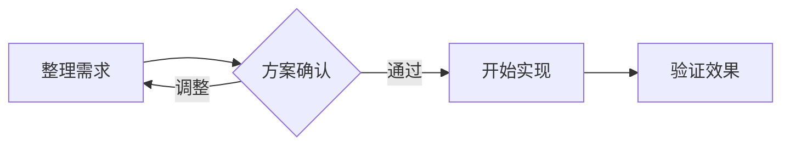

# Mermaid 编辑器

在画布上整理流程，在代码里保留细节。Mermaid 编辑器把源码编辑、图形操作和本地文件读写放在一个界面中，适合绘制业务流程、梳理系统关系，以及维护 Markdown 里的流程图。

项目提供浏览器版和 Windows 桌面版，两者共用编辑界面。图表始终以 Mermaid 文本保存，方便继续编辑、放进文档或交给 Git 管理。

## 编辑体验

- **代码与画布同步**：修改源码后更新预览，在画布上编辑后回写源码，两边共用撤销和重做历史。
- **直接修改流程图**：双击编辑文字，拖动连接点建立连线，拖动端点改变指向，调整节点形状、连线和样式。
- **批量整理节点**：框选、追加选择、批量修改，或把选中的节点放进新分组；支持调整节点所属分组、连接分组和解散分组。
- **切换图表方向**：点击方向按钮，在向下、向右、向上、向左之间循环切换，支持撤销。
- **留出画布空间**：源码区可收起再展开，保留光标、滚动位置和编辑历史；画布支持平移、缩放和触控板双指平移。
- **照顾中文内容**：支持中文节点 ID、中文界面，也可以切换到英文。

当前应用的画布交互面向流程图（`flowchart`）。其他图表类型通过源码编辑和 Mermaid 预览使用，暂不开放画布编辑。

## 本地启动

准备 Node.js 和 pnpm；仓库使用 `pnpm@10.33.0`。在仓库根目录执行：

```bash
pnpm install
pnpm dev
```

浏览器访问 <http://localhost:5173>。默认端口被占用时，开发服务会退出，可以指定其他端口：

```bash
pnpm --filter playground dev --host 127.0.0.1 --port 5174
```

使用 Codex 时，也可以点击项目里的“启动编辑器”操作，它使用 `5174` 端口。

把下面的内容粘贴到源码区，即可开始编辑：



## 打开与保存

支持 `.mmd`、`.mermaid`、`.md` 和 `.txt` 文件，也可以直接将文件拖入编辑器。

浏览器版通过“打开”读取本地文件，“保存”会下载编辑后的文件。Windows 桌面版通过系统对话框打开、保存和另存为，可直接写回原文件。

打开 Markdown 时，只编辑第一个完整的 Mermaid 围栏代码块，保留代码块外的正文。桌面版保存前会重新读取文件，以保留编辑期间发生的块外修改；发现外部改动时，会根据当前编辑状态重新加载或提示处理。

编辑器会记录本地草稿，发现未保存的内容时提供“恢复”和“丢弃”选项。标题中的 `*` 表示当前内容尚未保存。草稿用于恢复编辑现场，正式文件仍需主动保存。

## Windows 桌面版

桌面版使用 Go 和 WebView2，构建产物为 `dist/mermaid-editor.exe`。双击即可启动，也可以把文件路径作为启动参数。运行环境需要 Microsoft Edge WebView2 Runtime。

常用快捷键：

| 操作 | 快捷键 |
| --- | --- |
| 打开文件 | `Ctrl+O` |
| 保存 | `Ctrl+S` |
| 另存为 | `Ctrl+Shift+S` |

关闭未保存的文档时，可选择保存、不保存或取消。选择“不保存”会清除该文档的草稿。

在 Windows PowerShell 中构建，需要先安装前端依赖，并准备 Go 工具链：

```powershell
pnpm install
.\tools\windows\build.ps1
```

脚本会构建并内嵌前端页面，使用 Go 1.24.4 生成 Windows amd64 程序，再执行 Go 静态检查和测试。需要将程序复制到桌面时运行：

```powershell
.\tools\windows\build.ps1 -CopyToDesktop
```

应用数据和日志位于 `%LOCALAPPDATA%\mermaid-editor`，WebView2 数据放在其中的 `WebView2` 子目录。日志文件为 `mermaid-editor.log`，按 1 MiB 轮转。

## 开发与检查

```bash
pnpm test
pnpm typecheck
pnpm exec tsx tools/cases/run-cases.mts
```

构建编辑页面：

```bash
pnpm --filter playground build
```

产物位于 `apps/playground/dist/index.html`，前端脚本和样式打包到单个 HTML 中。根目录的 `pnpm build` 用于构建工作区里的基础包。

Windows 原生文件桥的冒烟检查需要在 Windows 上先构建桌面程序，再运行：

```powershell
node tools/windows/smoke.mjs
```

该检查使用独立数据目录，避免影响日常草稿。

## 目录导航

| 目录 | 内容 |
| --- | --- |
| `apps/playground` | 日常使用的编辑器界面、文件操作和草稿管理 |
| `cmd/mermaid-editor` | Windows 桌面程序入口 |
| `internal` | 原生文件读写、日志等 Go 模块 |
| `packages/core` | Mermaid 解析、编辑操作和撤销历史 |
| `packages/dom` | 画布交互、元素定位和界面语言 |
| `packages/codemirror` | CodeMirror 源码编辑器集成 |
| `packages/monaco`、`packages/react` | Monaco 和 React 集成 |
| `apps/js-playground`、`apps/mermaidraw` | 其他演示入口 |
| `tools`、`testdata` | 构建脚本、用例运行器和测试素材 |
