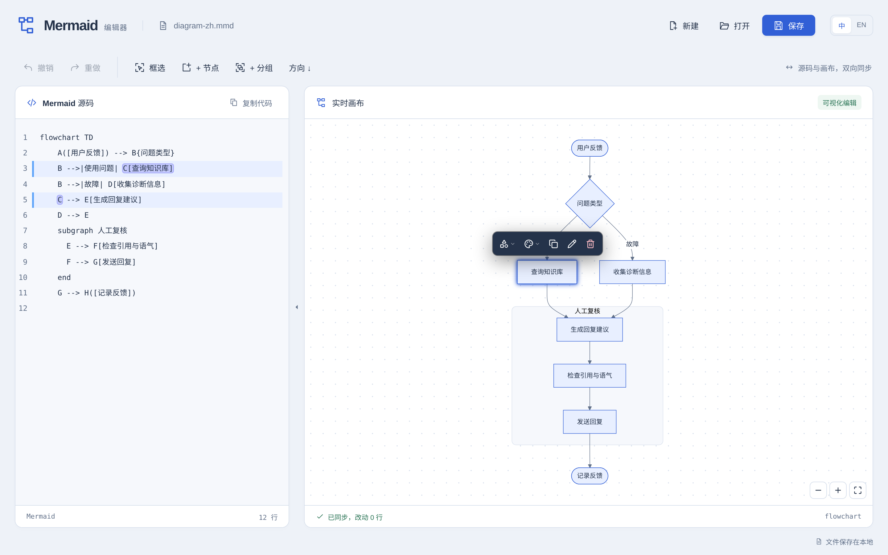
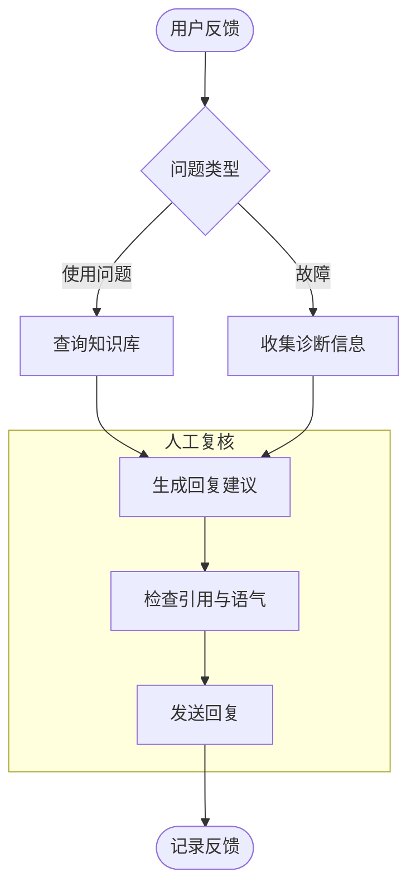

# Mermaid 编辑器

**中文** | [English](README.en.md)

> Agent 画图，你来微调。改 Mermaid 不用再和括号、箭头较劲。

Mermaid 编辑器是一个本地优先的可视化 Mermaid 编辑器，有浏览器版和 Windows 桌面版，两者共用同一套编辑界面。左边是 Mermaid 源码，右边是实时画布：双击节点改文字，拖圆点连线，选中后换形状和颜色，框选多个节点批量整理，点一下还能切换整张图的方向。画布上的编辑会同步写回 Mermaid 文本。

它最适合这个场景：让 ChatGPT、Claude、Cursor 等 Agent 先画出流程图，再把图放进编辑器里改到能交付、能进文档、能提交 Git。



## 示例和画布操作

首次打开且没有旧草稿时，会显示功能测试示例。点击顶部“示例”也可以随时载入；原文档的草稿会保留，载入操作可以撤销。“新建”仍然创建空白图。

从节点的蓝色圆点拉线到画布空白处，松手会直接创建新节点并连好线，不再弹出确认菜单。新节点自动进入改字状态；创建节点和连线可以一起撤销。拖到已有节点仍直接连线，按 Esc 或在画布外松手则取消。

示例包含画布菜单支持的 8 种节点形状、中文和换行文字、实线/虚线/粗线、无箭头/双向/圆点/叉号连线、连线标签、嵌套分组和分组连线，以及节点和连线样式。源码开头附有试用提示，可依次练习改字、改形状和颜色、复制与删除、连线与改指向、跨组拖动、多选归组、解散分组、方向切换、缩放平移、撤销重做和文件保存。

拖动节点或分组时，直接在主画布中对照移动前后的真实排版。相关对象的旧位置用灰色虚线保留，新布局以蓝色实线突出；其他内容只展示新排版，避免整张图重影。可以勾选“仅看移动后”，缩放和平移时对照会保持同一倍率和位置。停在目标位置后等待排版完成，松手应用，按 Esc 取消。排序支持同一分组、同一层且有共同入口的并列节点，可以保留节点的其他连线；入口到分支的连线需分行书写。独立且唯一的节点声明会与入口连线一起调整，连接关系、文字和样式保留，并继续检查实际画面顺序。示例中的“练习用节点”“短信通知”“站内通知”可以一起调整。节点菜单的“分支前移/后移”提供点击和键盘操作入口，先显示同样的预览，再点击“应用排版”保存。未完成、失败或无法保持所选顺序的预览不会改动原图，成功操作可一次撤销。复杂连接和任意坐标摆放仍受自动排版限制。

拖动分组的标题、边框或内部空白，可以带着内部节点、子组和内部连线一起移动。可整组移入、移出其他组，也可调整同一父组下并列分组的顺序；画布对照会确认实际排版是否满足所选顺序。示例中的两个通知组可练习排序，“履约分组”可练习整体拖出“支付分组”。分组菜单里的“整组前移/后移”和“移动整组”提供非拖动入口。分组不能放进自己或自己的子组，也不能形成分组与其内部成员互相连线的无效结构；不支持的源码写法和排版会保留原图。

拖动过程中，连到组外的线会实时跟着移动端伸缩，另一端保持固定，连线文字也会跟随中段。组内的线一起平移，箭头和线型保留；取消后恢复原位。停在合法目标处后，仍会切换为 Mermaid 算出的实际排版对照。

## 优势特点

- **改图不用翻源码**：改文案、换形状、调颜色、加分组、改连线，都在画布上完成。
- **源码和画布双向同步**：画布上的操作写回源码，源码的修改即时刷新画布；撤销和重做共用一份历史。
- **改动小，diff 干净**：每次操作只替换必要的文本，尽量保留原有注释、缩进和写法，代码评审更容易。
- **专为 Agent 产出设计**：直接粘贴生成的 Mermaid，或打开带 Mermaid 代码块的 Markdown，改完复制回对话。
- **本地优先**：文件在本地打开和保存，不经过服务器；桌面版直接写回原文件。
- **中英双语**：界面可随时切换中文 / English，中文节点 ID 也能正常编辑。

## 快速开始

需要 Node.js 和 pnpm（仓库使用 `pnpm@10.33.0`）：

```bash
pnpm install
pnpm dev
```

浏览器打开 <http://localhost:5173>。把 Agent 生成的 Mermaid 粘贴到左侧源码区，或把 `.mmd`、`.mermaid`、`.md`、`.txt` 文件拖进窗口。

默认端口被占用时，可以指定其他端口：

```bash
pnpm --filter playground dev --host 127.0.0.1 --port 5174
```

使用 Codex 时，也可以点击项目里的“启动编辑器”操作，它使用 `5174` 端口。

将下面的示例粘贴到源码区，即可开始编辑：



## 从 Agent 到成图

1. 让 Agent 输出一个 Mermaid 代码块。
2. 把代码粘进左侧源码区；如果是 Markdown，直接打开文件，编辑器只改第一个完整的 Mermaid 代码块，正文原样保留。
3. 在画布上微调：双击改字，拖连接点连线，选中换形状/颜色，框选后建分组，必要时切换方向。
4. 复制源码回到对话，或保存文件。桌面版会直接写回原文件。

## 能改什么

| 想改的地方 | 怎么操作 |
| --- | --- |
| 节点文字 | 双击节点，或选中后按 `Enter` / `F2`；输入后 `Enter` 确认，`Esc` 取消 |
| 节点形状 | 选中节点打开形状面板，在矩形、圆角矩形、体育场形、菱形、六边形、圆形、圆柱、子程序之间切换 |
| 节点颜色 | 选中节点打开颜色面板，分别调整填充、边框、文字颜色，或恢复默认 |
| 节点位置 | 拖动节点可以临时挪开重叠、看清连线；Mermaid 会自动布局，自由拖动不写回源码，拖进/拖出分组才会改写代码 |
| 新增连线 | 从节点边缘的蓝色圆点拖到另一个节点；拖到空白处会直接创建节点并连线 |
| 改变连线 | 选中连线，拖动两端的圆点改接到其他节点 |
| 连线样式 | 选中连线，切换实线 / 虚线 / 粗线，编辑标签或删除 |
| 增删节点 | 工具栏“+ 节点”新建；选中后按 `Delete` / `Backspace` 删除；节点菜单可复制 |
| 分组 | 框选或 `Shift` 多选节点后点“+ 分组”；把节点拖进/拖出分组；选中分组可改名或解散 |
| 批量修改 | 框选 / `Shift` 追加 / `Ctrl`（`⌘`）+`A` 全选，然后批量换形状、颜色、建组或删除 |
| 整图方向 | 工具栏“方向”在从上到下、从左到右、从下到上、从右到左之间循环，可撤销 |
| 画布视图 | 右下角缩放、适应画布；滚轮或触控板双指平移，`Ctrl`+滚轮缩放 |
| 源码区 | 可收起/展开，保留光标、滚动位置和编辑历史；“复制代码”一键复制 |

选中节点后，画布上会浮出常用操作；框选多个节点时只显示适用于整个选区的操作。

## 文件、草稿与撤销

- 图表始终以 Mermaid 文本保存，方便继续编辑、放进文档或交给 Git 管理。
- 编辑器会记录本地草稿。发现未保存的内容时可以恢复或丢弃；窗口标题末尾的 `*` 和文件名旁的圆点表示尚未保存。草稿只用于恢复编辑现场，正式文件仍需主动保存。
- 打开 Markdown 时只编辑第一个完整的 Mermaid 围栏代码块，代码块外的正文保留。桌面版保存前会重新读取文件，避免覆盖编辑期间发生的外部修改。
- 撤销和重做同时覆盖源码输入与画布操作，快捷键为 `Ctrl`（`⌘`）+`Z`、`Ctrl`（`⌘`）+`Shift`+`Z`。

## Windows 桌面版

桌面版使用 Go 和 WebView2，产物是 `dist/mermaid-editor.exe`。双击即可启动，也可以把文件路径作为启动参数；运行环境需要 Microsoft Edge WebView2 Runtime。

| 操作 | 快捷键 |
| --- | --- |
| 打开文件 | `Ctrl+O` |
| 保存 | `Ctrl+S` |
| 另存为 | `Ctrl+Shift+S` |

在 Windows PowerShell 中构建，需要先准备 Go 工具链（脚本使用 Go 1.24.4）和前端依赖：

```powershell
pnpm install
.\tools\windows\build.ps1
```

加 `-CopyToDesktop` 可以把程序复制到桌面。关闭有未保存修改的文档时，会询问保存、不保存还是取消；选择“不保存”会清除该文档的草稿。应用数据和日志位于 `%LOCALAPPDATA%\mermaid-editor`，日志为其中的 `mermaid-editor.log`。

## 开发与检查

```bash
pnpm test
pnpm typecheck
pnpm exec tsx tools/cases/run-cases.mts
pnpm --filter playground build
```

`pnpm --filter playground build` 生成单文件 `apps/playground/dist/index.html`；根目录的 `pnpm build` 构建工作区里的基础包。Windows 文件桥的冒烟检查需要在 Windows 上先构建桌面程序，再运行 `node tools/windows/smoke.mjs`。

## 目录

| 目录 | 内容 |
| --- | --- |
| `apps/playground` | 浏览器版编辑器界面、文件操作和草稿管理 |
| `cmd/mermaid-editor` | Windows 桌面程序入口 |
| `internal` | 原生文件读写、日志等 Go 模块 |
| `packages/core` | Mermaid 解析、编辑操作和撤销历史 |
| `packages/dom` | 画布交互、元素定位和界面语言 |
| `packages/codemirror` | CodeMirror 源码编辑器集成 |
| `packages/monaco`、`packages/react` | Monaco 和 React 集成 |
| `apps/mermaidraw`、`apps/js-playground` | 其他演示入口 |
| `tools`、`testdata` | 构建脚本、用例运行器和测试素材 |

## 当前范围

- 画布上的可视化编辑目前面向流程图（`flowchart`）。时序图、类图、状态图等其他类型可以通过源码编辑并实时预览，暂不开放画布拖改。
- Mermaid 的节点位置由布局计算。画布上自由拖动节点只影响当前显示，不会写回源码；需要改变布局时，请使用分组、增删节点或切换整图方向。
- 没有云端同步或账号体系，文件始终保存在本地。

## 许可证与致谢

本项目基于 [inkeep/mermaid-wysiwyg](https://github.com/inkeep/mermaid-wysiwyg) 的可视化编辑内核开发，并补充了本地文件读写、Windows 桌面壳和编辑器界面。项目以 MIT 许可证发布，见 [LICENSE](LICENSE)。
